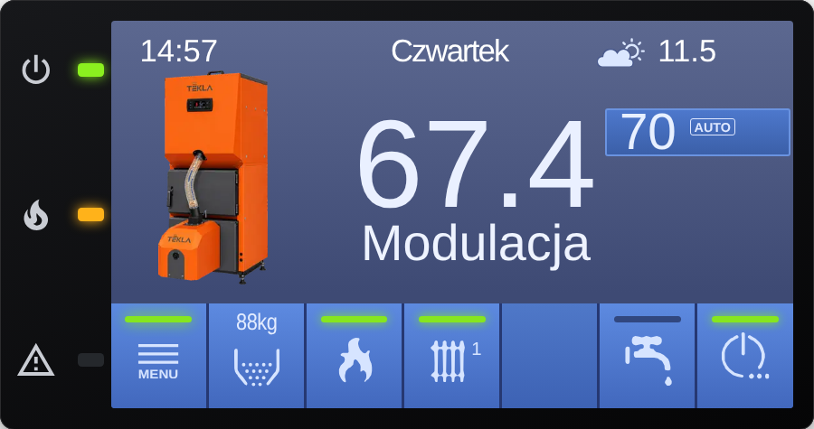
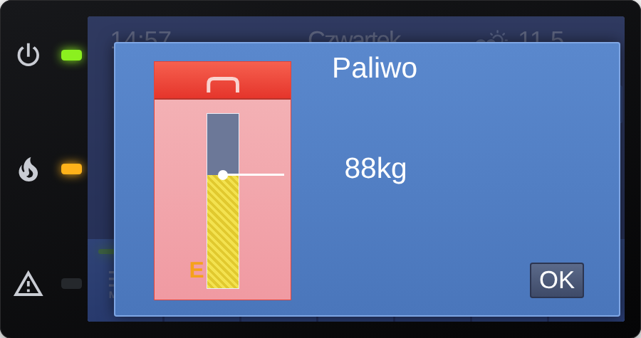
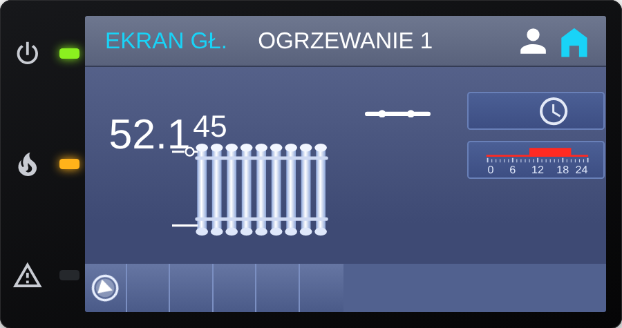
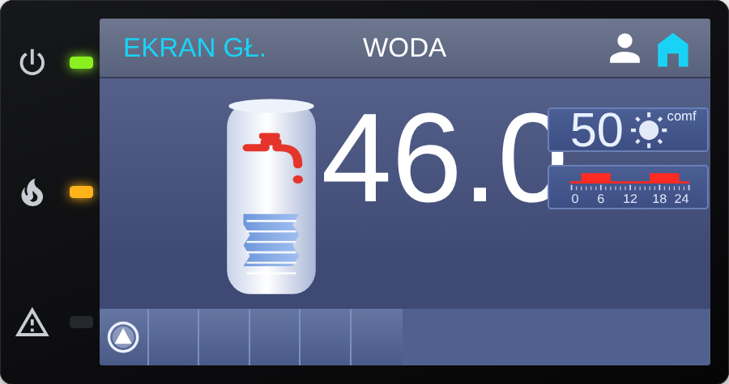
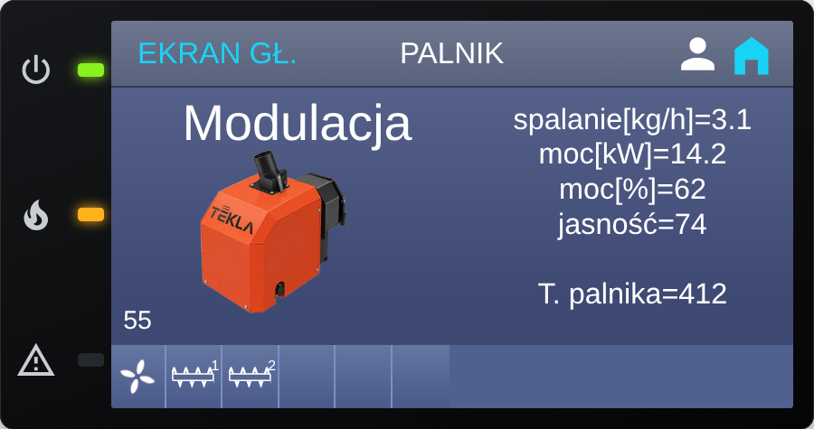
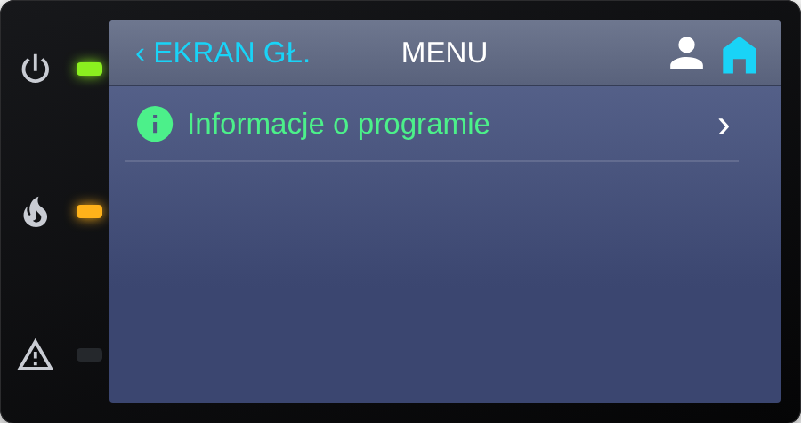

# PelletCAN lite

Wersja **lite** projektu [PelletCAN](https://github.com/GieOeRZet/PelletCAN): karta Home Assistant (HACS) i minimalny firmware ESPHome do **podglądu** kotła pelletowego Estyma / Tekla Igneo Touch przez CAN (XIAO ESP32-C6 + MCP2515). **Tylko odczyt** – nic nie jest zapisywane do kotła.

Projekt stworzony przez Romana Gorza (pomysł, kierunek, testy na własnej instalacji) z pomocą Claude – asystenta AI firmy Anthropic, który pomagał przy pisaniu kodu i dokumentacji.

<a href="https://buycoffee.to/ergie" target="_blank" rel="noopener"></a>

> ⚠️ Projekt nieoficjalny – nie zastępuje produktów Estyma. Używasz na własną odpowiedzialność; firmware tylko czyta rejestry kotła, ale podłączenie do magistrali CAN zawsze robisz sam.

> Zrzuty ekranu pochodzą z danych testowych (nie z działającego kotła).

| Ekran główny | Paliwo | Ogrzewanie 1 (CO) |
|---|---|---|
|  |  |  |

| Woda (CWU) | Palnik | Menu |
|---|---|---|
|  |  |  |

## Spis treści
1. [Co dostajesz](#co-dostajesz)
2. [Dolny pasek ekranu głównego](#dolny-pasek-ekranu-głównego)
3. [Sprzęt](#sprzęt)
4. [Firmware – instalacja](#firmware--instalacja)
5. [Karta – instalacja (HACS)](#karta--instalacja-hacs)
6. [Aktualizacje](#aktualizacje)
7. [Rozwiązywanie problemów](#rozwiązywanie-problemów)
8. [Struktura repozytorium](#struktura-repozytorium)

## Co dostajesz
- **Karta** `custom:pelletcan-lite-card`: ekran główny, okno **Paliwo** (zapełnienie zbiornika), **Ogrzewanie 1 (CO)**, **Woda (CWU)**, **Palnik** oraz **Menu** z jedną pozycją „Informacje o programie”. Zero edycji: nastawy, tryb pracy, harmonogram i podawanie nie są klikalne.
- **Firmware** w dwóch plikach: `esphome/PelletCAN_lite.yaml` (ten wgrywasz do ESP) i `esphome/PelletCAN_lite_packages.yaml` (rdzeń, ściągany z GitHuba przy kompilacji). Jeden obieg CO, bez usług zapisu.

Potrzebujesz pełnej wersji (zapis nastaw, harmonogramy, test wyjść, historia alarmów)? Zobacz [PelletCAN](https://github.com/GieOeRZet/PelletCAN).

## Dolny pasek ekranu głównego
Przyciski na dolnej belce pokazują też stany:
- **MENU** – pulsujący zielony wskaźnik, gdy w tym repozytorium jest nowsza wersja karty lub firmware (szczegóły w „Informacje o programie”).
- **Zasobnik** – ilość paliwa w kg i zapełnienie zasobnika w procentach (kropki w ikonie); dotknięcie otwiera okno Paliwo.
- **Płomień** – wskaźnik zielony: pulsuje przy rozpalaniu, świeci ciągle przy modulacji; czerwona ikona zakazu, gdy aktywny jest zakaz rozpalenia.
- **Grzejnik** – wskaźnik zielony, gdy pracuje pompa CO.
- **Kran** – wskaźnik zielony, gdy pracuje pompa CWU.
- **Power** – zielony wskaźnik: kocioł włączony, czerwony: wyłączony. Tylko informacja, bez klikania.
Dioda alarmu po lewej stronie panelu zapala się przy aktywnym alarmie.

## Sprzęt
Seeed **XIAO ESP32-C6** + **Seeed CAN Bus Breakout** (MCP2515, kwarc 16 MHz), podłączone do magistrali CAN kotła (125 kbit/s). Piny: SCK=D8, MISO=D9, MOSI=D10, CS=D7. Zworka P1 = terminator 120 Ω (zwykle niepotrzebna).

## Firmware – instalacja
1. W ESPHome utwórz urządzenie, wklej zawartość `esphome/PelletCAN_lite.yaml` (zmienia się tylko sekcja `substitutions`).
2. Obok pliku utwórz `secrets.yaml` wg `esphome/secrets.example.yaml` (`wifi_ssid_iot`, `wifi_pass`, `esp_api_key_tekla_CAN`, `ota_pass`).
3. **Install** – rdzeń pobiera się sam z tego repo przy każdej kompilacji (nowa wersja = ponowny Install).
4. Dodaj urządzenie w HA (integracja ESPHome, klucz API).

Ustawienia w pliku użytkownika: `wifi_ssid`, `wifi_password`, `ap_pass` (hasło awaryjnej sieci „Tekla-Estyma Fallback”), opcjonalnie stały IP (`device_ip`, `device_gateway`, `device_subnet` – odkomentuj razem z blokiem `wifi:` na dole), `api_key`, `ota_password`, `name`, `friendly_name`, `external_antenna` („true” tylko po podpięciu anteny U.FL). Parametry CAN są wpisane w rdzeniu.

## Karta – instalacja (HACS)
1. HACS → Frontend → menu ⋮ → **Własne repozytoria** → `https://github.com/GieOeRZet/PelletCAN_lite`, kategoria **Dashboard** → Pobierz.
2. HACS dodaje zasób `/hacsfiles/PelletCAN_lite/pelletcan-lite-card.js` (jeśli nie – dodaj ręcznie jako moduł JavaScript). Odśwież przeglądarkę (Ctrl+F5).
3. Dodaj kartę:
```yaml
type: custom:pelletcan-lite-card
```
Encje karta znajduje sama po końcówkach nazw (urządzenie „Tekla”). Gdy nazwałeś urządzenie inaczej, dodaj `entity_prefix: moj_prefiks` lub użyj edytora karty.

Wygląd i grafiki (`kociol.*`, `palnik.*`, `bojler.*`) – patrz [dist/img/README.md](dist/img/README.md). Karta może działać obok pełnej karty PelletCAN.

## Aktualizacje
Karta sprawdza plik `version.json` **tego** repozytorium (`GieOeRZet/PelletCAN_lite`). Gdy jest nowsza wersja karty lub firmware, MENU na ekranie głównym pulsuje, a w „Informacje o programie” widać opis zmian. Firmware aktualizujesz przyciskiem **Install** w ESPHome (rdzeń pobiera się z tego repo), kartę przez HACS.

## Rozwiązywanie problemów
- **Karta pokazuje „-”** – encje nie zostały znalezione: dodaj `entity_prefix:` z fragmentem nazwy urządzenia albo użyj edytora karty.
- **CAN OK = wyłączone** – sprawdź przewody CAN-H/CAN-L, zasilanie płytki i kwarc (16 MHz); po zmianie zasilania poczekaj ok. 1 minutę.
- **Karta nie zmienia się po aktualizacji** – odśwież przeglądarkę (Ctrl+F5) lub wyczyść pamięć podręczną aplikacji HA.
- **Harmonogramy pojawiają się po ok. 30 s od startu ESP**, potem odświeżają się co 5 minut.

## Struktura
- `dist/` – karta (`pelletcan-lite-card.js` + `pelletcan-lite-core.js` + `img/`), generowana skryptem `tools/build_lite.py` z kodu pełnej karty.
- `esphome/` – pliki firmware i wzór `secrets.yaml`.
- `version.json` – wersje karty i firmware (karta pokazuje dostępne aktualizacje w „Informacje o programie”).
